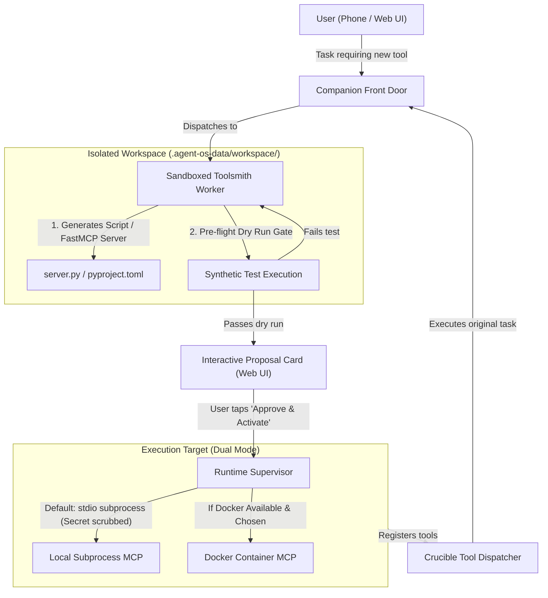

# ADR-0010: Pluggable MCP Architecture & Agentic Tool Factory

> **Date**: 2026-10-08  
> **Status**: Accepted  
> **Deciders**: Human Product Owner, AI Assistant  
> **Context**: Architectural definition of Crucible's tool bootstrapping engine, combining core agentic coding primitives, a native FastMCP subprocess hub, pre-seeded catalog connectors, and progressive container/git enhancement.

---

## 1. Context & Problem Statement

An autonomous system operating in real-world personal environments and homelabs faces the **Tool Bootstrapping Problem**:
1. **The Pre-Baked Tool Trap**: Relying solely on static, pre-packaged tools causes immediate dead-ends when a user requests an unfulfilled capability (e.g., custom homelab sensors, ZFS pool queries, or unique automation scripts).
2. **The Raw Shell Dilemma**: Giving an agent unrestricted raw host terminal execution risks catastrophic command execution, prompt injection escapes, and high failure rates on small local LLMs (14B–30B) that struggle with complex bash quoting and unformatted stdout.
3. **The Heavy Dependency Barrier**: Forcing every tool or integration into Docker containers imposes severe barriers (Docker Desktop RAM bloat, daemon installation requirements, failure on lightweight machines), alienating non-technical users.
4. **Over-Engineering Runbooks into MCP**: Wrapping simple, linear automation scripts (Ansible playbooks, Terraform configs) into persistent MCP servers creates unnecessary complexity. Scripts are executable runbooks; MCP is for continuous, queryable APIs.

---

## 2. Decision Drivers

* **Zero Hard Dependencies (Progressive Enhancement)**: Crucible must function completely out-of-the-box with zero required external container engines (Docker/Podman) or Git installations. If Docker, Podman, or Git exist on the host, Crucible progressively unlocks them.
* **True Agentic Coding**: Equip isolated workers with foundational software engineering primitives (`view_file`, `write_to_file`, `run_command`) so Crucible can develop code, Ansible playbooks, and Terraform scripts natively.
* **Typed JSON Contracts via MCP**: Recurring operational tools must expose typed JSON schemas rather than raw shell strings, maximizing local LLM reliability and enabling granular policy gating.
* **Safe Toolsmithing Pipeline**: Dynamically synthesized tools must pass an automated pre-flight dry-run gate and human approval before registration into the active runtime.
* **Separation of Scopes**: The agent's internal tooling/memory workspace (`.agent-os-data/workspace/`) must remain cleanly separated from user-specified project codebases (`~/projects/...`).
* **Environment Secret Scrubbing**: Subprocess workers and tool servers must never inherit parent runtime API keys, database credentials, or ambient environment secrets.

---

## 3. Decision Outcome: The 4-Pillar Tooling Architecture

We establish a unified, four-pillar tooling model:

```
┌────────────────────────────────────────────────────────────────────────┐
│                        CRUCIBLE TOOLING MATRIX                         │
├───────────────────────────────┬────────────────────────────────────────┤
│ 1. Built-in Coding Primitives │ • File Inspect & Edit (view/write/patch)│
│    (Shipped with Crucible)    │ • Sandboxed Command Runner (run_command)│
│                               │ • System Diagnostics & Wiki / Notes   │
├───────────────────────────────┼────────────────────────────────────────┤
│ 2. The Built-in FastMCP Hub   │ • Lightweight stdio subprocess (no     │
│    (Crucible's Dynamic Tools) │   Docker needed, starts in <50ms).     │
│                               │ • Agent develops, tests & dry-runs     │
│                               │   new @mcp.tool() functions.           │
│                               │ • User approves on phone -> Live!      │
├───────────────────────────────┼────────────────────────────────────────┤
│ 3. Pre-Seeded Catalog Recipes │ • Ready-made recipes to mount standard │
│    (Off-the-shelf MCPs)       │   MCPs (Docker, GitHub, Blender, etc.) │
│                               │ • Plus a UI Config tab to paste any    │
│                               │   custom command or SSE endpoint.      │
├───────────────────────────────┼────────────────────────────────────────┤
│ 4. External Custom MCPs       │ • If user prefers hosting a dedicated  │
│    (Homelab / Docker / Remote)│   homelab container or remote server,  │
│                               │   Crucible connects via standard SSE.  │
└───────────────────────────────┴────────────────────────────────────────┘
```



### 3.1 Pillar 1: Built-in Agentic Coding Primitives
Sandboxed workers receive three core primitives scoped to an active project directory:
* `workspace_read` / `workspace_tree`: Inspect files, view lines, search symbols.
* `workspace_write` / `workspace_patch`: Create new files or apply surgical diffs.
* `workspace_command`: Run commands (e.g. `uv run pytest`, `ansible-playbook --syntax-check`, `terraform plan`) with strict execution timeouts, output byte clamping (1MB max), and environment secret scrubbing.

### 3.2 Pillar 2: The Built-in FastMCP Hub
Crucible hosts a native, managed FastMCP server (`crucible_custom_mcp.py`) operating over `stdio`:
* **Zero Container Requirement**: Runs via Python / `uv` as a child process. Consumes ~20MB RAM and launches in $<50$ms.
* **The Toolsmith Specialist**: When a novel capability is requested, a specialist worker drafts the tool function with `@mcp.tool()` typed parameters and docstrings.
* **Mandatory Pre-Flight Dry Run**: The worker runs a synthetic dry-run call with sample arguments. If it throws an exception or crashes, it is never proposed to the user.
* **Cryptographic Locking**: Approved tools are locked by SHA-256 hash. Code drift disables the tool until re-reviewed.

### 3.3 Pillar 3: Pre-Seeded Catalog Connectors & UI Config
* **Seeded Recipes**: Crucible ships with pre-configured recipe definitions for common community MCP servers (e.g. Docker container inspector, GitHub PR manager, SQLite explorer). Invoking the recipe launches the standard open-source MCP binary via `uvx` or `npx` automatically.
* **Custom Endpoint UI**: A dedicated Settings view allows power users to paste custom `stdio` launch commands or remote HTTP/SSE URLs (e.g. `http://192.168.1.50:8000/sse`), test the handshake, and mount tools with one click.

### 3.4 Pillar 4: External Containerized MCP Support
For homelab users who prefer containerized isolation:
* Crucible supports connecting to Docker- or Podman-hosted MCP servers over HTTP/SSE.
* If Docker daemon is detected and containerization is requested, the Toolsmith generates a `Dockerfile` and builds/launches the container using standard container commands.

---

## 4. Policy Tiers & Security Boundaries

1. **Tier 1 (Autonomous Execution)**: Read-only operations (`get_status`, `list_items`, `read_logs`, syntax checks) execute automatically without interrupting the user.
2. **Tier 2 (Human Approval Gate)**: State-mutating operations (`reboot_host`, `delete_container`, `apply_terraform`, activating newly synthesized tools) pause execution and present an interactive approval card in the Web UI.
3. **Secret Scrubbing**: Subprocess launchers scrub all environment variables matching `*(KEY|TOKEN|SECRET|PASSWORD|AUTH|CREDENTIAL|PRIVATE)*`, passing only safe OS baseline variables (`PATH`, `SYSTEMROOT`, `LANG`).
4. **Dangerous Command Filter**: Subprocess runners block destructive commands (`rm -rf /`, raw disk formatting, fork bombs).

---

## 5. Consequences & Trade-offs

### Positive
* **Zero Entry Barrier**: Anyone can download and run Crucible immediately without installing Docker or Git.
* **Elimination of Capability Dead-Ends**: Crucible can write software, build custom homelab tools, and adapt on the fly.
* **High Reliability for Small Local Models**: Small models interact via typed JSON schemas instead of error-prone shell scripts.
* **Standard-Aligned**: Fully compliant with the official Model Context Protocol specification and Unix subprocess model.

### Negative & Mitigations
* **Child Process Lifecycle Management**: Subprocess MCP servers can become orphaned if Crucible terminates abruptly.  
  *Mitigation*: Implement a POSIX/Windows process group death supervisor (inspired by Hermes Agent) to kill child process trees on shutdown.
* **Dependency Isolation**: Custom user tools may require third-party Python packages.  
  *Mitigation*: Use `uv` ephemeral environments (`uv run --with <package> ...`) to prevent polluting host Python installations.
